# 🎓 Caccia di laurea


[](LICENSE)

**Una caccia al tesoro da terminale per festeggiare una laurea magistrale in
Bioinformatica.** Nove sezioni sigillate in archivi zip annidati, un tavolo di
invitati che fa le domande, un barista complice, due buste nascoste e un sorso per
ogni errore. Si gioca su un portatile al bar, subito dopo la proclamazione.

<p align="center">
  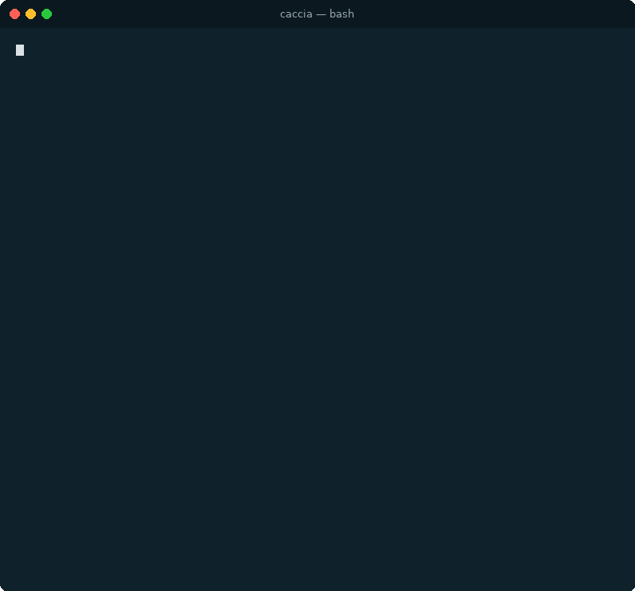
</p>

> [!WARNING]
> **Spoiler.** Questo README e la cartella `docs/` contengono tutte le soluzioni. Se
> sei tu a dover giocare, fermati qui.

---

## Indice

- [🧪 Cos'è](#cose)
- [🧬 Per chi è](#per-chi-e)
- [🗺️ Il percorso](#percorso)
- [🔬 Le nove sezioni](#sezioni)
- [🍸 Le regole del tavolo](#regole)
- [🛟 Niente si blocca](#niente-si-blocca)
- [⚙️ Requisiti](#requisiti)
- [🚀 Avvio rapido](#avvio-rapido)
- [🎉 Il giorno della festa](#festa)
- [🛠️ Personalizzarla](#personalizzarla)
- [🏗️ Come funziona dentro](#dentro)
- [📁 Struttura del repo](#struttura)
- [❓ Domande frequenti](#faq)
- [📜 Licenza](#licenza)

---

<a name="cose"></a>

## 🧪 Cos'è

Una caccia al tesoro che vive in una cartella. Chi gioca apre un terminale, lancia
`bash start.sh` e trova davanti a sé una pratica di laboratorio da chiudere: otto
sezioni sigillate una dentro l'altra, come scatole cinesi. Ogni sezione contiene
qualcosa da risolvere e la sezione successiva, protetta da una password. La password
non è mai scritta in chiaro: va trovata.

Gli enigmi si spostano di continuo fra lo schermo e la stanza. Alcune chiavi stanno nei
file, altre in una galleria o in un quiz nel browser, altre ancora **fuori dal
computer**: in una busta attaccata sotto il tavolo, nelle mani del barista, nelle
risposte che gli invitati danno a voce. Alla fine c'è un sequenziatore da caricare, un
brindisi da fare in piedi e un referto che chiude la caccia.

È nata come regalo vero, per una festa di laurea vera. Questa è la versione
anonimizzata e pronta da riusare:

- chi gioca non ha nome né genere: nei testi è solo «la pratica GR-2026»;
- le password sono segnaposto, da `PASSWORD-1` a `PASSWORD-8`;
- le foto della galleria e del quiz sono riquadri vuoti che indicano il file atteso;
- i ricordi del quaderno sono lorem ipsum e i videomessaggi sono cartelli senza volti.

Tutto quello che serve per farne una caccia vera è descritto in
[Personalizzarla](#personalizzarla).

<a name="per-chi-e"></a>

## 🧬 Per chi è

La caccia è costruita su un **profilo da bioinformatico**, a metà fra due mondi.

| 🧫 Laboratorio | 💻 Terminale |
| --- | --- |
| provette, gel, western blot, citofluorimetro | file nascosti e `ls -a` |
| un quaderno di laboratorio da 1248 righe | `head` e `tail` per leggerne solo i pezzi giusti |
| un archivio di 2000 campioni | `grep` per trovare l'unica riga che conta |
| sette campioni da analizzare | `cat` su ogni referto |
| un sequenziatore da caricare | `cp` con un percorso da ricostruire a mano |

Gli enigmi mescolano i due campi: chi gioca deve riconoscere i riferimenti di
laboratorio e muoversi in una shell senza paura. Non serve però saper programmare. I
comandi sono spiegati per esteso nel momento in cui servono, e il manuale della prima
sezione li elenca tutti: al bar, davanti al tavolo e con qualche sorso in corpo, un
dettaglio di sintassi non deve fermare il gioco.

Il repertorio è chiuso e volutamente piccolo:

```text
ls   ls -a   cd   pwd   cat   head -n   tail -n   grep   mv   cp   unzip   bash script.sh
```

Niente pipe, niente redirezioni, niente `chmod`.

<a name="percorso"></a>

## 🗺️ Il percorso

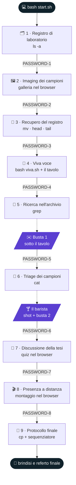

Le sezioni sono zip annidati: `step2.zip` sta dentro `step1/`, `step3.zip` dentro
`step2/`, e così via. Ogni archivio si apre con la password trovata nella sezione
precedente.

```text
caccia/
├── start.sh
└── step1/
    ├── README.txt   manual.txt   .protocol   specimen.dat
    └── step2.zip  🔒 PASSWORD-1
        └── step2/
            ├── README.txt   gallery.html   logbook.txt
            └── step3.zip  🔒 PASSWORD-2
                └── step3/
                    └── step4.zip  🔒 PASSWORD-3
                        └── …  fino a step9/
```

<a name="sezioni"></a>

## 🔬 Le nove sezioni

| # | Sezione | Dove si gioca | Comando nuovo | Errore = sorso |
| :-: | --- | --- | --- | :-: |
| 1 | 🗂️ Registro di laboratorio | terminale | `ls -a` | |
| 2 | 🖼️ Imaging dei campioni | browser | — | ✅ |
| 3 | 📓 Recupero del registro | terminale | `mv`, `head -n`, `tail -n` | |
| 4 | 🎤 Viva voce | terminale + tavolo | `bash script.sh` | ✅ |
| 5 | 🔎 Ricerca nell'archivio | terminale + sotto il tavolo | `grep` | |
| 6 | 🧫 Triage dei campioni | terminale + bancone del bar | `cat` | ✅ |
| 7 | 📝 Discussione della tesi | browser | — | ✅ |
| 8 | 🎬 Presenza a distanza | browser | — | |
| 9 | 🧬 Protocollo finale | terminale + tutti in piedi | `cp` | |

Ogni sezione si apre allo stesso modo: `unzip stepN.zip`, `cd stepN`, `cat README.txt`.
Il README di ogni sezione spiega cosa fare e finisce dicendo come passare alla
successiva.

### 1 · 🗂️ Registro di laboratorio

Il primo README dice che la chiave è già nella cartella, ma non si vede. Il manuale
cita un'opzione di `ls` «per le cose che si nascondono»: `ls -a` rivela un file che
comincia col punto.

<p align="center">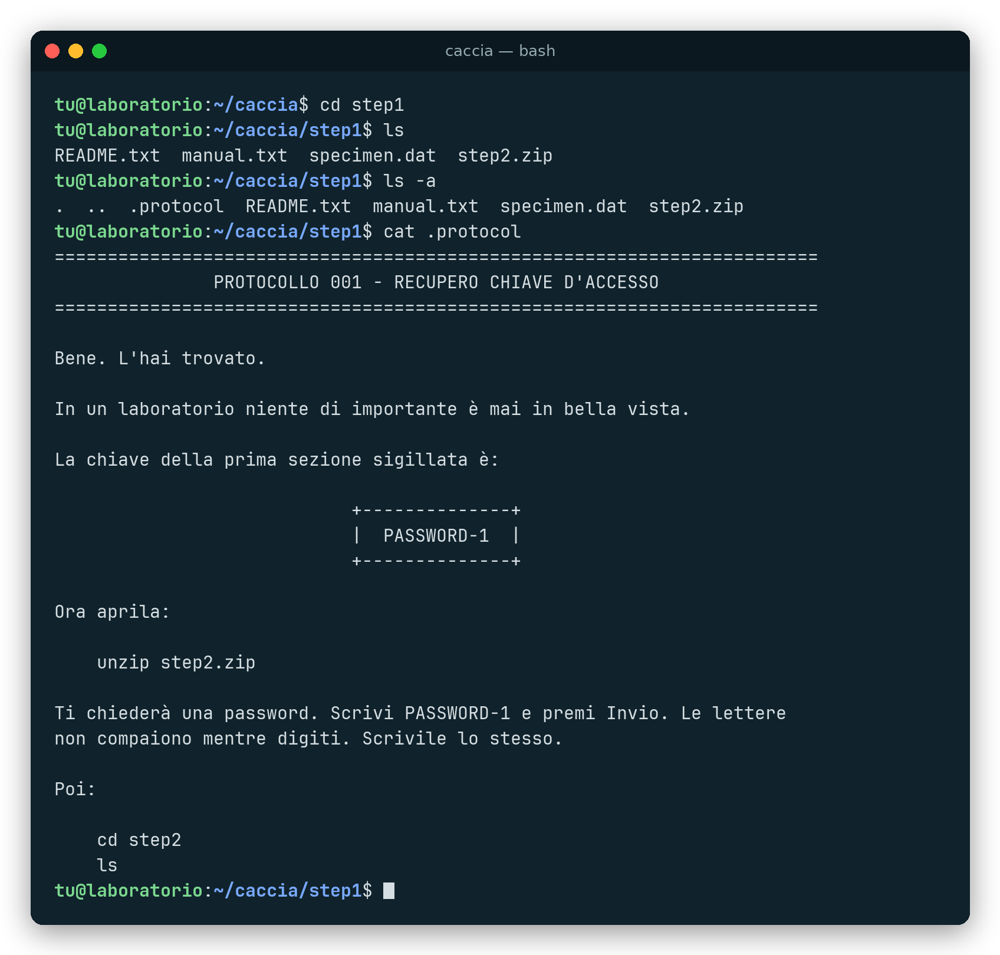</p>

<details>
<summary>🔑 Soluzione</summary>

`ls -a`, poi `cat .protocol`: la chiave è `PASSWORD-1`.

</details>

### 2 · 🖼️ Imaging dei campioni

`gallery.html` è un referto fotografico con 15 schede coperte. Un clic gira la scheda e
mostra foto, didascalia e data di raccolta; un secondo clic segna il campione. Hanno
superato il controllo qualità solo i campioni raccolti **durante la magistrale**, da
ottobre 2024 in poi. Le lettere dei campioni giusti si compongono in cima alla pagina,
in ordine di figura.

- La scelta è definitiva: un campione segnato non si può più togliere.
- Un campione fuori corso diventa rosso, trema e fa comparire il cartello «Bevi un
  sorso».
- Le lettere non si scrivono a mano: la pagina distribuisce da sola la parola `CHIAVE`
  sulle foto valide.

<p align="center">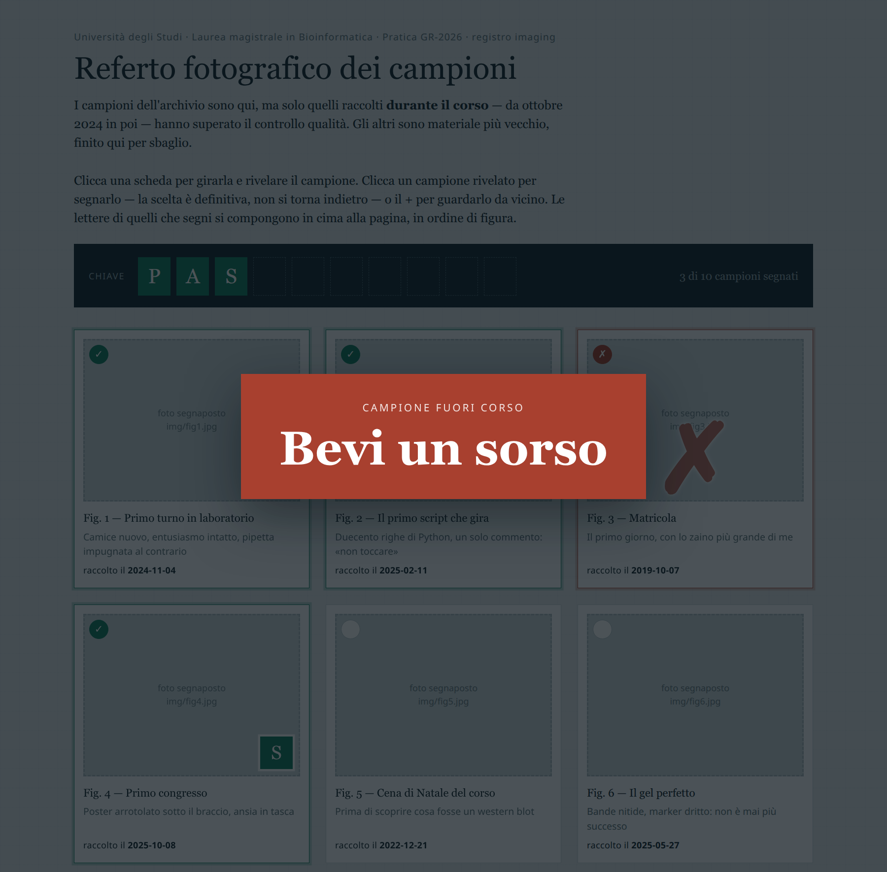</p>

<details>
<summary>🔑 Soluzione</summary>

Sono valide le figure 1, 2, 4, 6, 7, 9, 10, 12, 13 e 15: compongono `PASSWORD-2`.

</details>

### 3 · 📓 Recupero del registro

Nella sezione 3 c'è solo il README: il quaderno di laboratorio è rimasto «sullo
scaffale sbagliato», nella sezione 2. Il README precedente lo aveva nominato apposta:
«non puoi ancora usarlo, lascialo». Va riportato con `mv ../logbook.txt .`.

Il quaderno ha 1248 righe e quasi 400 voci. Nessuno lo legge tutto: il README concede
solo `head -n 31` e `tail -n 26`. In testa ci sono i ricordi, in coda le dediche e una
voce finale che rimanda in cima.

<details>
<summary>🔑 Soluzione</summary>

`head -n 31 logbook.txt`: nel quinto ricordo c'è l'unica parola in maiuscolo,
`PASSWORD-3`. L'ultima voce di `tail -n 26` dice dove guardare.

</details>

### 4 · 🎤 Viva voce

`bash viva.sh` conduce una seduta di laurea, ma le domande non sono nello script: lo
schermo dice solo **a chi rivolgersi** («Chi ti conosce da più tempo», «Mamma», …).
Quella persona, al tavolo, fa la sua domanda a voce, e chi gioca scrive la risposta.

- Vale ogni risposta che **contiene** la parola attesa; maiuscole e minuscole non
  contano.
- Una persona può avere più soprannomi (`"Mamma|Mammina"`): a ogni giro ne esce uno a
  caso.
- Risposta sbagliata: `[ RIFIUTATA ] … >> BEVI UN SORSO <<`. Dopo tre errori la
  commissione è «di manica larga» e la domanda passa comunque.
- La chiave arriva scritta a macchina, con uno spoiler in ritardo.

<p align="center">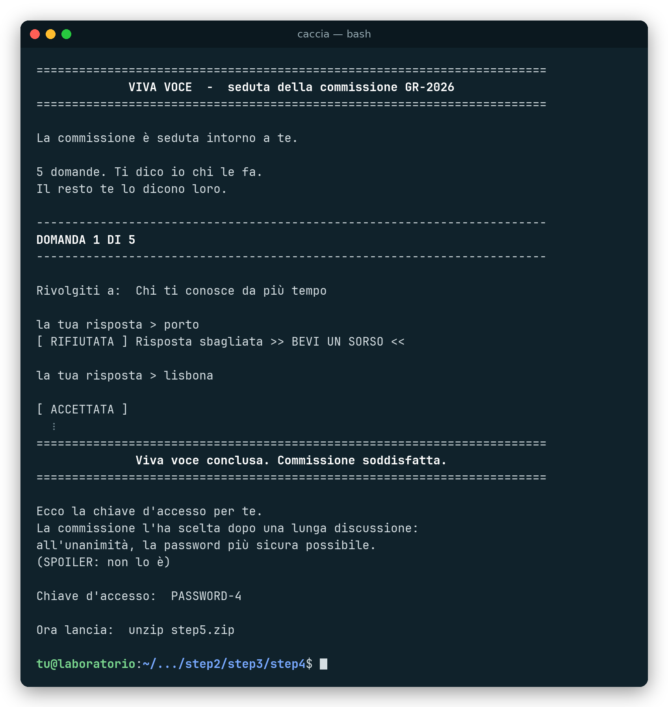</p>

<details>
<summary>🔑 Soluzione</summary>

Le cinque domande, con le risposte accettate, stanno in
[`docs/CHI-DICE-COSA.md`](docs/CHI-DICE-COSA.md). Alla fine lo script stampa
`PASSWORD-4`.

</details>

### 5 · 🔎 Ricerca nell'archivio

`archive.csv` è l'export di un database di laboratorio: 2000 righe, sei colonne
(`campione_id`, `patient_code`, `collected_on`, `assay`, `status`, `notes`). Il README
dà il codice del campione personale, `GR2026`, e ricorda che esiste «uno strumento che
lo legge per te». La riga trovata non contiene la chiave: dice dove andarla a prendere,
**nel mondo vero**.

<details>
<summary>🔑 Soluzione</summary>

`grep GR2026 archive.csv` rimanda alla busta sigillata attaccata sotto il tavolo.
Dentro c'è `PASSWORD-5`.

</details>

### 6 · 🧫 Triage dei campioni

Sette campioni, da `sample_A.txt` a `sample_G.txt`. Sei vanno scartati (contaminati,
scaduti, degradati, del laboratorio di sopra, vuoti), ognuno con la nota del tecnico e
un `BEVI UN SORSO` in fondo. Uno solo è valido, e chiede un reagente che in
laboratorio non c'è: bisogna andare al bancone e ordinare **«UN REAGENTE BIANCO»**.

Il barista versa uno shot, controlla che venga bevuto fino all'ultima goccia e solo
dopo consegna la seconda busta.

<p align="center">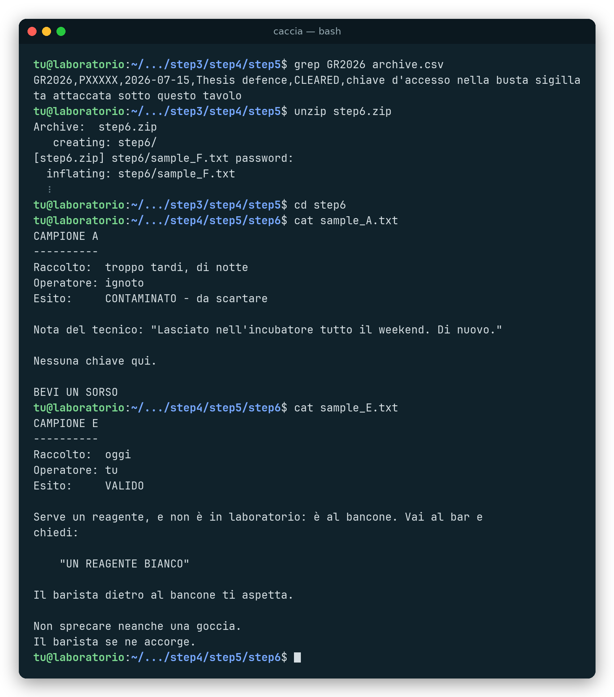</p>

<details>
<summary>🔑 Soluzione</summary>

Il campione giusto è `sample_E.txt` (il G sembra quello giusto, ma è vuoto). La busta 2
del barista contiene `PASSWORD-6`.

</details>

### 7 · 📝 Discussione della tesi

`defense.html` è la «verifica della commissione»: dieci domande personali a scelta
multipla, alcune con un pulsante «Guarda la foto». Si inviano tutte insieme.

- Le risposte giuste diventano verdi e si bloccano.
- Le sbagliate diventano rosse e fanno comparire il cartello «Risposte da rivedere —
  Bevi un sorso».
- Le risposte mancanti non fanno bere: sono una dimenticanza, non un errore.
- Con tutte giuste la commissione decide all'unanimità e mostra la chiave.

<p align="center">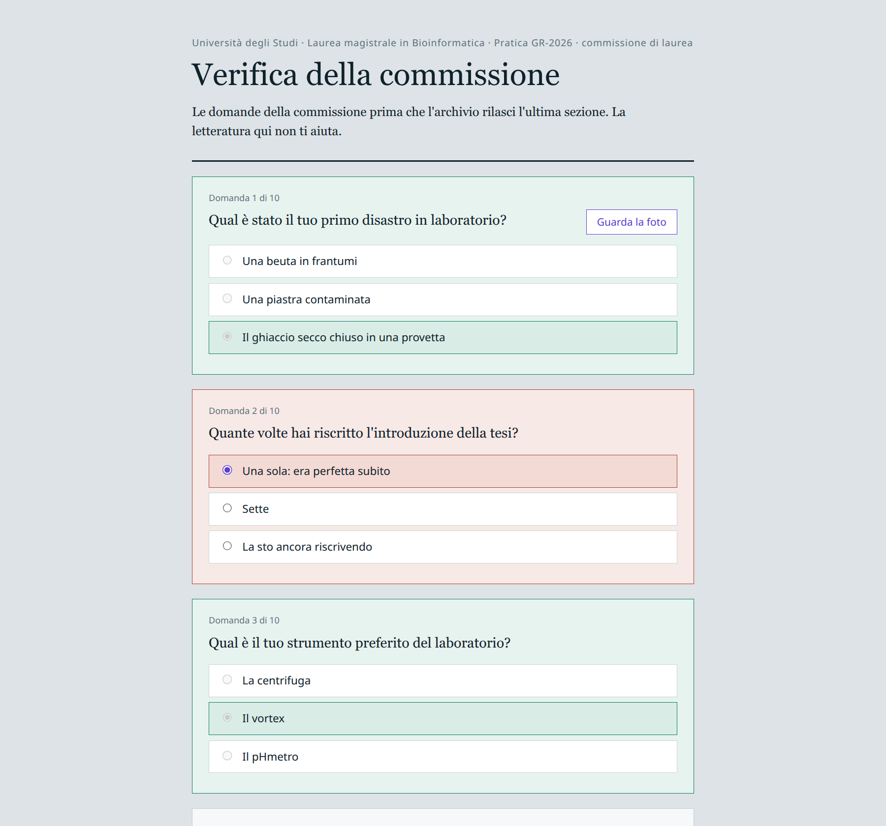</p>

<details>
<summary>🔑 Soluzione</summary>

Risposte in ordine: C B B C B A B B A C. La chiave è `PASSWORD-7`.

</details>

### 8 · 🎬 Presenza a distanza

`messages.html` è un montaggio dei videomessaggi di chi non è potuto venire. Fra un
video e l'altro compare una parola a schermo intero, con la scritta «tieni a mente
questa parola». Le parole, in ordine e attaccate, sono la password.

Si avanza da soli o con Avanti, Indietro e le frecce. Una barra mostra l'avanzamento e
i pallini indicano a che punto si è; se il browser blocca l'autoplay, compare un
grande Play.

<p align="center">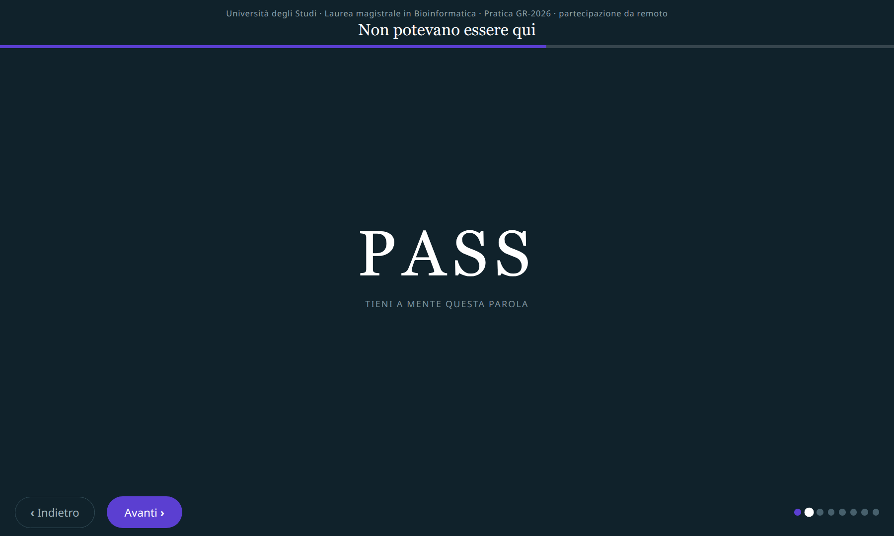</p>

<details>
<summary>🔑 Soluzione</summary>

Le parole sono `PASS`, `WORD`, `-`, `8`: la chiave è `PASSWORD-8`.

</details>

### 9 · 🧬 Protocollo finale

L'ultima sezione contiene il sequenziatore, `thesis_defense.sh`, ma lanciato a vuoto
risponde solo con un errore: nessun campione caricato. Il campione grezzo,
`specimen.dat`, è rimasto in `step1`, **otto cartelle più in alto**. Va copiato qui
ricostruendo il percorso a mano: con `pwd` e il percorso assoluto, oppure con un `..`
per ogni sezione.

<p align="center">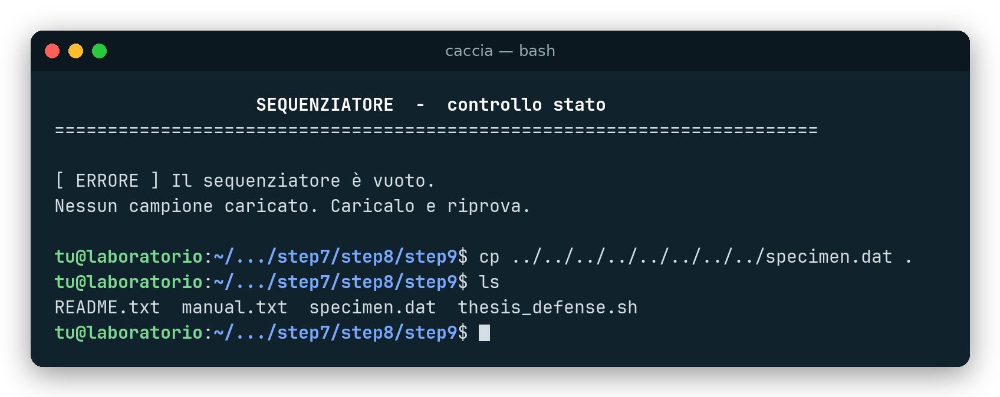</p>

Con il campione caricato parte la corsa: barre di avanzamento, un'anomalia nei
risultati e l'ordine di alzarsi in piedi, calice in mano, per ringraziare commissione,
relatore, colleghi e compagni di studi, mentre il tavolo registra. Dopo l'Invio partono
i fuochi d'artificio in ASCII e il sequenziatore scrive il referto finale.

<table>
  <tr>
    <td>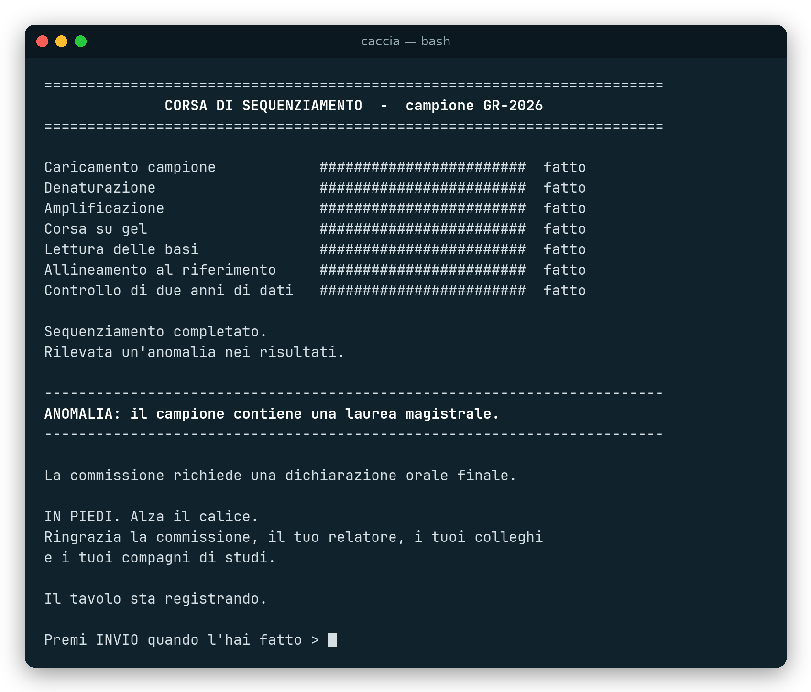</td>
    <td>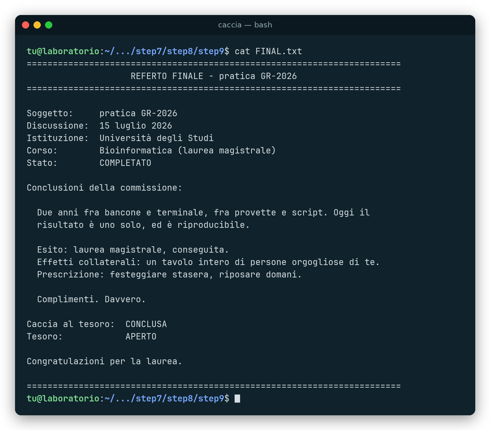</td>
  </tr>
</table>

<details>
<summary>🔑 Soluzione</summary>

Da `step9`:

```bash
cp ../../../../../../../../specimen.dat .
bash thesis_defense.sh
cat FINAL.txt
```

</details>

<a name="regole"></a>

## 🍸 Le regole del tavolo

Il pegno del gioco è un sorso. Il sistema lo chiede da solo in tre punti:

| Dove | Quando | Cosa compare |
| --- | --- | --- |
| 🖼️ Galleria | si segna una foto fuori corso | scheda rossa che trema, cartello «Bevi un sorso» |
| 🎤 Viva voce | una risposta viene rifiutata | `[ RIFIUTATA ] Risposta sbagliata >> BEVI UN SORSO <<` |
| 📝 Quiz | si inviano risposte sbagliate | cartello «Risposte da rivedere — Bevi un sorso» |

A questi si aggiungono i sei campioni da scartare dello step 6, che finiscono tutti con
`BEVI UN SORSO`.

C'è poi una quarta regola, annunciata nel briefing iniziale e fatta rispettare dal
tavolo: **si gioca solo dal terminale**, con i comandi del manuale. Aprire o modificare
i file a mano, se un README non lo chiede, costa un sorso.

Il testo dice sempre solo «bevi un sorso», così vale per qualsiasi bevanda, analcolici
compresi.

<a name="niente-si-blocca"></a>

## 🛟 Niente si blocca

Al bar non c'è tempo per il debug. Ogni passaggio ha una via d'uscita:

| Se succede che… | …la caccia fa così |
| --- | --- |
| una foto manca | compare un riquadro tratteggiato con il nome del file atteso |
| un video non parte | si va avanti con Avanti o con le frecce |
| il browser blocca l'autoplay | compare un pulsante Play |
| la seduta riceve tre risposte sbagliate | la domanda passa comunque |
| la password è sbagliata | `unzip` risponde `incorrect password` e si riprova |
| manca `unzip` o `grep` sul portatile | `start.sh` lo segnala e dice cosa installare |
| la festa va accorciata | la guida di chi organizza ha lo sblocco d'emergenza con `unzip -P` |

<a name="requisiti"></a>

## ⚙️ Requisiti

| | Serve |
| --- | --- |
| 🏗️ Per costruirla | `bash` e `zip` |
| 🎮 Per giocarla | un portatile Linux con `bash`, `unzip` e `grep`, un terminale e un browser |
| 🌐 Rete | nessuna |
| 📦 Da installare | niente |

Le pagine HTML sono file singoli con CSS e JavaScript inline: niente CDN, niente font
esterni, niente framework. I font sono stack di sistema e gli script sono bash puro.
`start.sh` controlla gli strumenti all'avvio e, se ne manca uno, suggerisce il
pacchetto `apt` da installare.

<a name="avvio-rapido"></a>

## 🚀 Avvio rapido

**1. Costruire la caccia.**

```bash
cd pacchetto
bash build.sh
```

`build.sh` chiude ogni sezione in uno zip cifrato e la annida nella precedente.
Produce `output/caccia/`, la cartella da copiare sul portatile, e `output/caccia.zip`,
la stessa cosa in un solo file. Non tocca mai `sorgente/`, si può rilanciare quante
volte si vuole e alla fine stampa l'ordine delle chiavi.

**2. Provarla per intero** su una copia, prima della festa:

```bash
cp -r output/caccia /tmp/prova && cd /tmp/prova/step1
unzip -P PASSWORD-1 step2.zip && cd step2
unzip -P PASSWORD-2 step3.zip && cd step3
unzip -P PASSWORD-3 step4.zip && cd step4
unzip -P PASSWORD-4 step5.zip && cd step5
unzip -P PASSWORD-5 step6.zip && cd step6
unzip -P PASSWORD-6 step7.zip && cd step7
unzip -P PASSWORD-7 step8.zip && cd step8
unzip -P PASSWORD-8 step9.zip && cd step9
cp /tmp/prova/step1/specimen.dat . && bash thesis_defense.sh
```

Le tre pagine HTML vanno aperte davvero in un browser: click, cartelli e video non si
verificano leggendo il codice.

**3. Il giorno della festa** si apre un terminale dentro `caccia/` e si lancia:

```bash
bash start.sh
```

> [!IMPORTANT]
> Sul portatile va solo `output/caccia/`, mai il repo: il repo contiene le soluzioni.

<a name="festa"></a>

## 🎉 Il giorno della festa

La caccia ha bisogno di qualche complice e di due fogli di carta.

**Prima che arrivi chi gioca:**

- ✉️ **busta 1** attaccata con il nastro sotto il piano del tavolo;
- 🍸 **busta 2** al barista, con l'accordo: alla frase «UN REAGENTE BIANCO» versa lo
  shot, controlla che venga bevuto tutto e solo dopo consegna la busta;
- 🥤 da bere per i sorsi di penitenza;
- 💻 terminale aperto nella cartella `caccia`, testo ingrandito, `bash start.sh` già
  lanciato e briefing lasciato a schermo;
- 🗂️ accanto, una finestra dei file aperta su `caccia`: le pagine `.html` si aprono con
  un doppio clic da lì.

**I documenti in `docs/`:**

| File | Per chi | Cosa contiene |
| --- | --- | --- |
| [`GUIDA.md`](docs/GUIDA.md) | chi organizza | tutte le password, l'aiuto da dare a ogni step, cosa fare se qualcosa va storto, lo sblocco d'emergenza |
| [`CHI-DICE-COSA.md`](docs/CHI-DICE-COSA.md) | il tavolo e il barista | la scaletta della festa, le domande della seduta con le risposte accettate, cosa fa il barista, il brindisi finale |
| [`buste.html`](docs/buste.html) | chi stampa | le due buste |

Le buste si stampano aprendo `buste.html` nel browser: A4 verticale al 100%, una busta
per foglio, scritta nella metà alta, da piegare a metà. Con `#1` o `#2` in fondo
all'indirizzo la pagina ne mostra una sola.

<p align="center">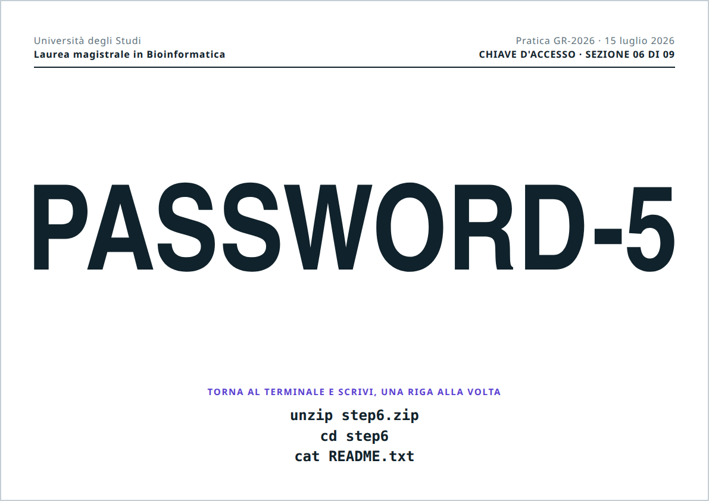</p>

<a name="personalizzarla"></a>

## 🛠️ Personalizzarla

Tutto quello che si modifica sta in `pacchetto/sorgente/`. Ogni pagina e ogni script
ha un blocco di configurazione, in cima o in fondo, con un commento in italiano che
spiega cosa toccare e cosa no.

| Cosa | Dove |
| --- | --- |
| 🔑 password | `pacchetto/build.sh` e il punto dove chi gioca le scopre |
| 🖼️ foto della galleria e date | `step2/img/` e la lista `PHOTOS` in `step2/gallery.html` |
| 📓 ricordi del quaderno | testa e coda di `step2/logbook.txt` |
| 🎤 chi chiede cosa nella seduta | `WHO` e `ANSWER` in `step4/viva.sh`, domande in `docs/CHI-DICE-COSA.md` |
| 📝 quiz | `step7/img/` e la lista `QUIZ` in `step7/defense.html` |
| 🎬 videomessaggi | `step8/media/` e la lista `SEQUENCE` in `step8/messages.html` |
| 🧾 referto finale | `step9/thesis_defense.sh` |
| ✉️ buste | la lista `BUSTE` in `docs/buste.html` |

### 🔑 Le password

Le password di questa versione sono comode per provarla, ma prevedibili: dalla
seconda in poi si indovinano senza risolvere niente. **Per una caccia vera vanno
cambiate tutte**, sempre in MAIUSCOLO (le password zip distinguono maiuscole e
minuscole) e senza accenti.

Ogni password sta in due posti, ed è il punto più fragile del progetto:

| Password | In `build.sh` | Dove la scopre chi gioca |
| --- | --- | --- |
| `PASSWORD-1` | `KEY2` | `step1/.protocol` |
| `PASSWORD-2` | `KEY3` | la variabile `CHIAVE` in `gallery.html` |
| `PASSWORD-3` | `KEY4` | il quinto ricordo di `logbook.txt` |
| `PASSWORD-4` | `KEY5` | la riga `KEY=` di `viva.sh` |
| `PASSWORD-5` | `KEY6` | busta 1 (`BUSTE` in `buste.html`) |
| `PASSWORD-6` | `KEY7` | busta 2 (`BUSTE` in `buste.html`) |
| `PASSWORD-7` | `KEY8` | il `<p class="word">` in fondo a `defense.html` |
| `PASSWORD-8` | `KEY9` | le righe `word` di `SEQUENCE` in `messages.html`, attaccate |

Dopo ogni cambio: ricostruire e rigiocare tutto su una copia.

### 🖼️ La galleria

```js
var CHIAVE = "PASSWORD-2";      // uguale a KEY3 in build.sh
var CUTOFF = "2024-10-01";      // inizio della magistrale

var PHOTOS = [
  { fig:1, date:"2024-11-04", title:"Fig. 1 — Primo turno in laboratorio",
    desc:"Camice nuovo, entusiasmo intatto, pipetta impugnata al contrario",
    file:"img/fig1.jpg" },
  { fig:3, date:"2019-10-07", title:"Fig. 3 — Matricola", desc:"…", file:"img/fig3.jpg" },
  // …
];
```

Sono valide le foto con `date` dal `CUTOFF` in poi; le altre sono le esche. L'unica
regola: **il numero di foto valide deve essere uguale alla lunghezza di `CHIAVE`**. Se
non torna, la console del browser lo segnala. Ogni foto può avere anche un `video`
facoltativo, che compare nell'ingrandimento.

### 📓 Il quaderno

`logbook.txt` va riempito in testa e in coda, cioè nelle righe che si leggono con
`head -n 31` e `tail -n 26`. Se cambia il numero di righe, va aggiornato anche nel
README dello step 3 e nel manuale. Le circa 360 voci centrali sono riempitivo da
laboratorio in inglese che nessuno legge: servono solo a rendere il file troppo lungo
per leggerlo tutto.

### 🎤 La seduta

```bash
WHO=(
  "Chi ti conosce da più tempo"
  "Mamma|Mammina"            # più soprannomi: ne esce uno a caso
  # …
)
ANSWER=(
  "lisbona"
  "lasagn"                   # vale sia "lasagne" sia "lasagna"
  # …
)
KEY="PASSWORD-4"
```

Le due liste devono avere la stessa lunghezza. Basta che la risposta digitata
**contenga** la parola, quindi conviene tenerla corta. Meglio non mettere due domande
di fila alla stessa persona.

### 📝 Il quiz

```js
{ q:"Qual è stato il tuo primo disastro in laboratorio?",
  a:["Una beuta in frantumi", "Una piastra contaminata", "Il ghiaccio secco chiuso in una provetta"],
  ok:2,                          // indice della risposta giusta
  fig:"img/quiz_provetta.jpg" }, // facoltativo: pulsante "Guarda la foto"
```

Numerazione, punteggio e sblocco della chiave si adeguano da soli al numero di
domande.

<a name="montaggio-video"></a>

### 🎬 Il montaggio

```js
var SEQUENCE = [
  { type:"video", src:"media/msg1.mp4", who:"La nonna" },
  { type:"word",  text:"PASS" },
  { type:"image", src:"media/foto.jpg", caption:"didascalia" },
  // …
];
```

I video vanno in **H.264**, non HEVC: i telefoni recenti registrano in HEVC, che Chrome
su Linux mostra come schermo nero con l'audio. La conversione uniforma anche il volume e
riduce a 1080p:

```bash
ffmpeg -i originale.mov -vf "scale=-2:'min(1080,ih)'" \
  -c:v libx264 -crf 20 -preset veryfast -pix_fmt yuv420p \
  -af loudnorm=I=-16:TP=-1.5:LRA=20 -ar 48000 -c:a aac -b:a 192k \
  -movflags +faststart msg5.mp4
```

### 🧾 Il referto

Il testo finale sta in `step9/thesis_defense.sh`, fra le righe che scrivono
`FINAL.txt`. È il messaggio personale della caccia: il posto giusto per le parole di
chi organizza.

<a name="dentro"></a>

## 🏗️ Come funziona dentro

**La costruzione.** `build.sh` copia `sorgente/` in una cartella temporanea e mette una
copia di `manual.txt` in ogni sezione. Poi, partendo dalla 9 e risalendo fino alla 2,
chiude ogni `stepN` in `stepN.zip` con la sua password e lo sposta dentro `step(N-1)`.
Alla fine resta solo `step1/`, che contiene tutto il resto a matrioska.

**Le chiavi della galleria.** Le lettere non stanno nel codice: la pagina filtra le foto
con data valida e assegna a ciascuna, in ordine di figura, la lettera successiva della
parola `CHIAVE`. Per cambiare la soluzione basta cambiare le date.

**Il terminale.** Tutti i testi che si leggono nel terminale sono allineati a mano su
**72 colonne**: cornici di `=` lunghe 72, titoli centrati, nessuna riga oltre. Così si
leggono bene anche con il testo ingrandito. Gli script usano il grassetto ANSI solo se
l'uscita è un terminale vero, scrivono alcune frasi a macchina e lasciano pause
apposta, per dare tempo al tavolo di reagire.

**Gli script si lanciano con `bash`.** Mai `./script.sh`: richiede i permessi di
esecuzione, che dopo una copia o un'estrazione possono mancare. `bash script.sh`
funziona sempre.

**Nessuno stato.** Niente salvataggi e niente server: lo stato della caccia è solo
quali zip sono stati aperti. Se si chiude il terminale, si riparte dalla cartella in cui
si era.

<a name="struttura"></a>

## 📁 Struttura del repo

```text
.
├── README.md
├── LICENSE                   MIT
├── CLAUDE.md                 vincoli e convenzioni del progetto
├── docs/
│   ├── GUIDA.md              per chi organizza: password, aiuti, emergenze
│   ├── CHI-DICE-COSA.md      scaletta per il tavolo e il barista
│   ├── buste.html            le due buste da stampare
│   └── screenshot/           le immagini di questo README
└── pacchetto/
    ├── build.sh              costruisce la caccia
    ├── sorgente/             tutto quello che si modifica
    │   ├── start.sh          controllo degli strumenti e briefing
    │   ├── step1/            manuale, README, .protocol, specimen.dat
    │   ├── step2/            gallery.html, logbook.txt
    │   ├── step3/            solo il README
    │   ├── step4/            viva.sh
    │   ├── step5/            archive.csv
    │   ├── step6/            sample_A.txt … sample_G.txt
    │   ├── step7/            defense.html
    │   ├── step8/            messages.html, media/
    │   └── step9/            thesis_defense.sh
    └── output/               prodotto da build.sh, non versionato
```

[`CLAUDE.md`](CLAUDE.md) raccoglie tutti i vincoli del progetto: chiavi duplicate,
repertorio di comandi chiuso, niente dipendenze, niente genere, larghezza dei testi. Va
letto prima di modificare qualcosa.

<a name="faq"></a>

## ❓ Domande frequenti

<details>
<summary><b>«incorrect password», ma la password è giusta</b></summary>

Quasi sempre è una lettera minuscola: le password zip distinguono maiuscole e
minuscole. Le lettere non compaiono mentre si digita, quindi un errore non si vede.
Basta riprovare con calma.

</details>

<details>
<summary><b>Il video del montaggio è nero, ma si sente l'audio</b></summary>

Il video è in HEVC. Va convertito in H.264 con il comando della sezione
[Il montaggio](#montaggio-video).

</details>

<details>
<summary><b>Il montaggio non parte da solo</b></summary>

Alcuni browser bloccano l'autoplay dei video con audio. La pagina se ne accorge e mostra
un grande pulsante Play: un clic e si parte.

</details>

<details>
<summary><b>Funziona su macOS o Windows?</b></summary>

È pensata e provata su Linux. Su macOS la `bash` di sistema è troppo vecchia per alcuni
script; su Windows serve WSL. Le pagine HTML funzionano in qualsiasi browser.

</details>

<details>
<summary><b>Chi gioca può sbirciare le soluzioni?</b></summary>

Non dal portatile: lì c'è solo la cartella costruita, con gli zip cifrati. Le soluzioni
stanno nel repo e nei documenti in `docs/`, che restano a chi organizza.

</details>

<a name="licenza"></a>

## 📜 Licenza

Distribuita con licenza [MIT](LICENSE): si può usare, copiare, modificare e
ridistribuire liberamente, anche per la propria festa, mantenendo l'avviso di
copyright.

---

<p align="center">
  Nata per una festa di laurea vera, tra provette, script e un tavolo di persone
  orgogliose. 🥂
</p>
